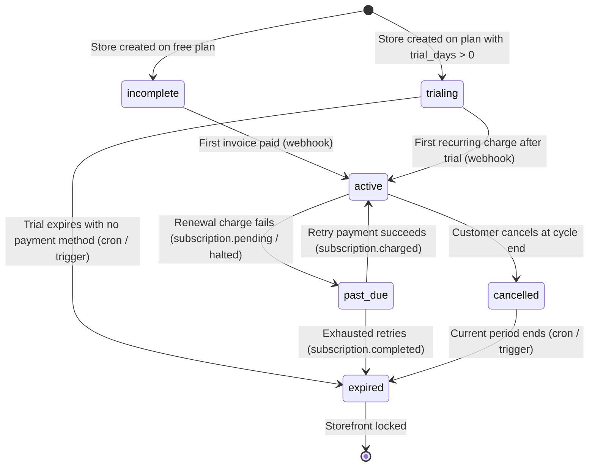

# Subscription Billing Architecture (Razorpay)

This document explains how subscription lifecycles, Razorpay integrations, webhook processing, plan switching, and security operate within SaaS Commerce Kit.

---

## 1. Subscription Status Lifecycle



### State Definitions
- **`incomplete`**: The store was initialized on a paid plan but no payment method has been verified yet.
- **`trialing`**: The store is actively in its free trial period (`now() <= trial_ends_at`). Customer storefront is fully open.
- **`active`**: Razorpay has received a valid payment authorization or recurring charge (`subscription.activated` or `subscription.charged`). Storefront is fully open.
- **`past_due`**: Renewal charge failed (`subscription.pending` or `subscription.halted`). A warning banner is displayed to the vendor. Access continues during the retry grace period.
- **`cancelled`**: The vendor scheduled cancellation. Access continues until `current_period_end`, at which point it lapses to `expired`.
- **`expired`**: Subscription period has ended without payment. The public customer storefront is locked (`is_open = false`), rendering a friendly *"This store is temporarily unavailable"* screen.

---

## 2. Free Trial Transition to Recurring Billing

When a vendor initiates checkout during an active trial (`startCheckout` in `src/features/subscriptions/actions.ts`):
1. The future timestamp `trial_ends_at` is converted to Unix seconds.
2. The Razorpay subscription is provisioned with `start_at = Math.floor(trial_ends_at / 1000)`.
3. The customer authorizes their card or UPI mandate via Razorpay Checkout.js.
4. **Zero immediate charges occur**: Razorpay verifies the payment method and schedules the first real debit for the exact second the free trial concludes.
5. Once the trial concludes, Razorpay charges the card and emits `subscription.charged`.

---

## 3. Webhook Architecture & Security

### Why Client Callbacks Are Never Trusted
In client-side single-page applications, the browser's `handler(response)` callback cannot be trusted to update database subscription states:
- Network disconnects or user closing the tab can prevent the callback from running.
- Malicious clients could counterfeit the response object.
- **Authoritative Rule**: Only verified server-side webhooks (`/api/webhooks/razorpay`) update `subscriptions.status` and record `subscription_payments`.

### Polling Mechanism
After the vendor completes payment in Razorpay Checkout.js:
1. The checkout dialog displays *"Confirming payment with bank..."*.
2. The client calls `getSubscriptionStatusAction(tenantId)` every 3 seconds (up to 60 seconds).
3. As soon as the webhook arrives and writes `status = 'active'`, the client receives the update, shows a success toast, and refreshes the dashboard.

### Webhook Signature Verification
- In `src/lib/billing/razorpay.ts`, `verifyWebhookSignature(rawBody, signature, secret)` computes an HMAC-SHA256 hash using the raw HTTP request body string.
- Hashes are compared using `crypto.timingSafeEqual` to safeguard against timing attacks.
- Invalid signatures immediately return HTTP 400.

### Idempotency
- Razorpay payments emit both `subscription.charged` and individual payment events.
- In `subscription_payments`, the column `razorpay_payment_id` has a unique constraint.
- The webhook performs an `upsert` with `ignoreDuplicates: true` on `razorpay_payment_id`, ensuring duplicate webhook deliveries never create duplicate payment records.

---

## 4. Plan Upgrade & Downgrade Strategy

Razorpay allows in-place subscription updates for standard subscriptions via:
```ts
rzp.subscriptions.update(subscriptionId, {
  plan_id: newPlanId,
  schedule_change_at: 'now' | 'cycle_end',
});
```

- When switching between monthly and yearly billing or tiers with different feature sets:
  - If Razorpay allows in-place modification, `updateRazorpaySubscription` updates the plan in Razorpay and records the target `plan_id` in Supabase.
  - If direct modification is restricted (e.g. interval change between month and year), the existing subscription is cancelled at cycle end (`cancel_at_period_end = true`), and the vendor selects their new plan upon cycle conclusion.

---

## 5. Local Webhook Testing

To test Razorpay webhooks on `http://localhost:3000`:

1. **Expose your local server with a tunnel**:
   ```bash
   # Using cloudflared:
   cloudflared tunnel --url http://localhost:3000

   # Or using ngrok:
   ngrok http 3000
   ```
2. **Configure Razorpay Dashboard**:
   - Go to [Razorpay Dashboard](https://dashboard.razorpay.com/) -> **Settings** -> **Webhooks**.
   - Add new Webhook: `https://<YOUR_TUNNEL_URL>/api/webhooks/razorpay`.
   - Set a Secret (e.g. `test_webhook_secret_123`) and paste it into `.env.local` as `RAZORPAY_WEBHOOK_SECRET`.
   - Subscribe to events:
     - `subscription.authenticated`
     - `subscription.activated`
     - `subscription.charged`
     - `subscription.pending`
     - `subscription.halted`
     - `subscription.cancelled`
     - `subscription.completed`
     - `payment.failed`
3. Test using Razorpay's test card or UPI details provided in their developer documentation.
